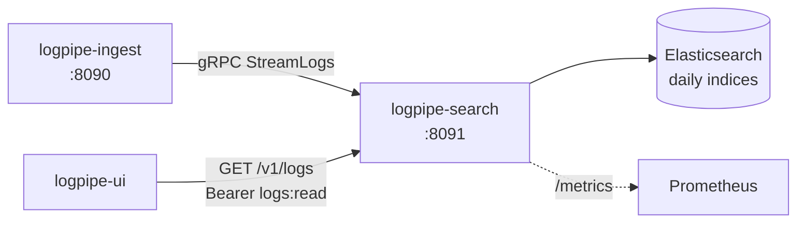

# logpipe-search

[](https://github.com/TiagoR85/logpipe-search/actions/workflows/ci.yml)
[](LICENSE)

Search tier of the logpipe family: receives log entries over gRPC from the ingest tier, validates them against the shared contract rules, and indexes them into Elasticsearch as daily indices. Also the family's query API host (fuzzy search, facets, trace view) with scope-protected endpoints validated via OIDC discovery against the ingest issuer.



## Status

Part of the logpipe family — see [logpipe-ui](https://github.com/TiagoR85/logpipe-ui) for the one-command demo (coming soon).

## Running tests

The contract package is fetched from its tagged source into a local feed **before** restore:

```powershell
pwsh ./scripts/fetch-contracts.ps1 -Ref v1.0.0
dotnet test tests/LogPipe.Search.Tests/LogPipe.Search.Tests.csproj -c Release
```

Tests use Testcontainers (Elasticsearch) — Docker must be running.

## Decisions

- [ADR-0001](docs/adr/ADR-0001-elasticsearch-storage.md) — daily indices `logs-yyyy.MM.dd`, template `logpipe-logs`, doc id = entry id for idempotent retries
- [ADR-0002](docs/adr/ADR-0002-oidc-discovery-validation.md) — pure resource server via JwtBearer discovery; no shared secrets

## Roadmap

- Search API: fuzzy query + level/service facets + trace view
- Retention: hourly index maintenance + `logs-current` alias
- Scope policies (`logs:read`) on the query endpoints
- UI + hub compose wiring

## About this repository

This repository is part of a personal study project (the "github-portfolio-dotnet" portfolio). It was built with heavy use of AI-assisted development tools, but it is held to production standards on purpose: automated tests with a coverage gate, CI on every push, fail-fast configuration, structured logging, and honest documentation of trade-offs. It is not affiliated with any employer or client.

## License

MIT — see [LICENSE](LICENSE).
